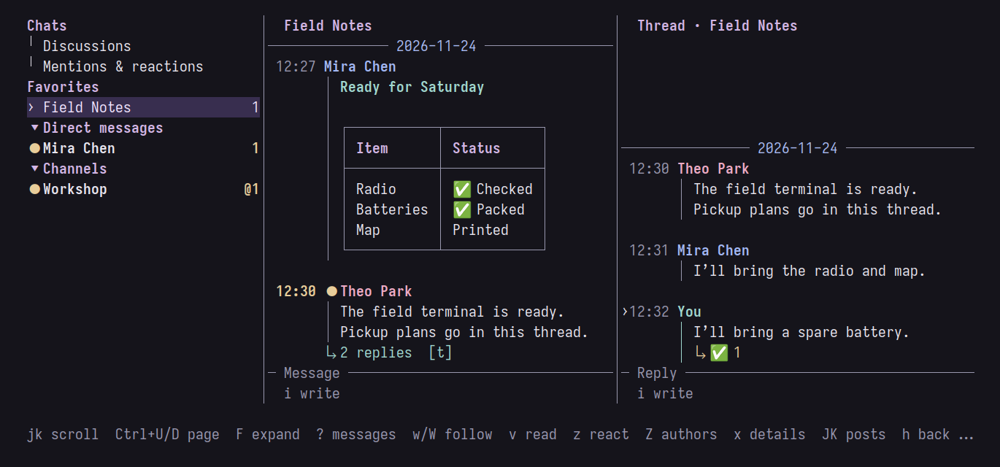

# Loop TUI

**Loop and Mattermost in your terminal.** Follow threads, find unread chats, and reply with Vim-style navigation.

## Try it

Build with Go 1.26 or newer.

```sh
go build -o loop-tui .
./loop-tui --demo
```

Open **Field Notes** with `Enter`, use `j` and `k` to move, and press `t` on a message with replies. The demo uses fictional chats offline.



## Connect to your server

```sh
./loop-tui --server https://chat.example.org
```

Enter an access token for that server when prompted. You can set `LOOP_SERVER` and pass the token through `LOOP_TOKEN` for noninteractive startup. Your administrator controls whether personal access tokens are available. [Mattermost token documentation](https://docs.mattermost.com/developers/integrate/reference/personal-access-token)

## What you can do

- **Follow conversations.** Switch between favorites, unread chats, followed threads, and mentions.
- **Search and reply.** Find chats by name or username, search messages, and keep drafts across restarts.
- **Work with attachments.** Pick files by path, paste screenshots, and preview images in Kitty or Sixel terminals.

Thread and activity features depend on the server’s API. Desktop notifications use `notify-send` where available.

[Keyboard shortcuts and setup](docs/usage.md) · [Apache 2.0 license](LICENSE)

Loop TUI shares terminal components with [Telega](https://github.com/danilrwx/telega).
